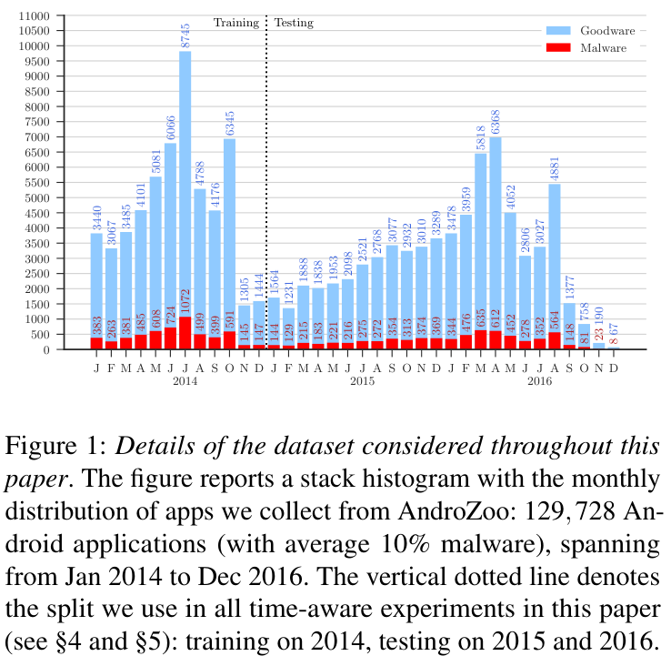
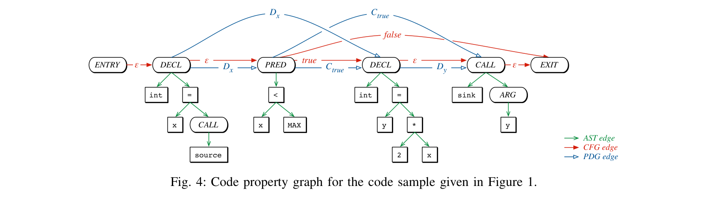
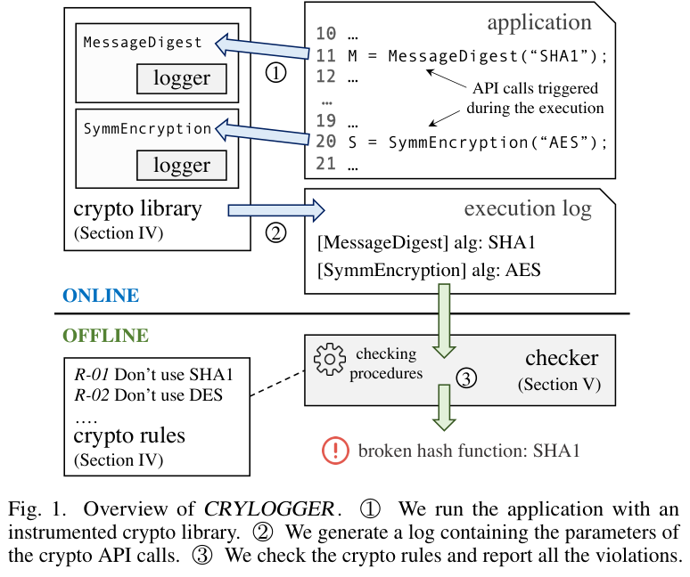
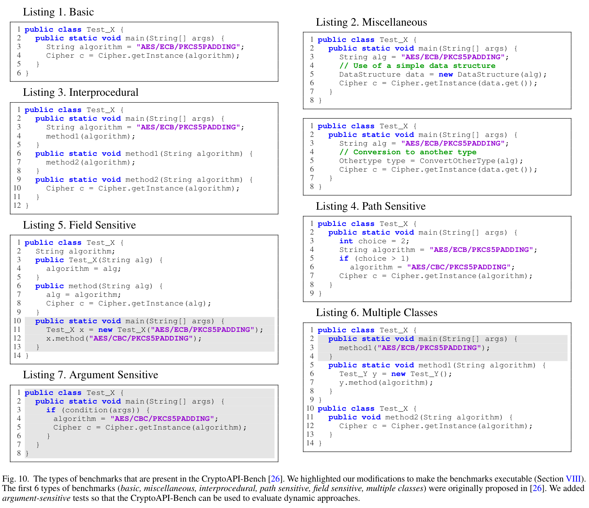
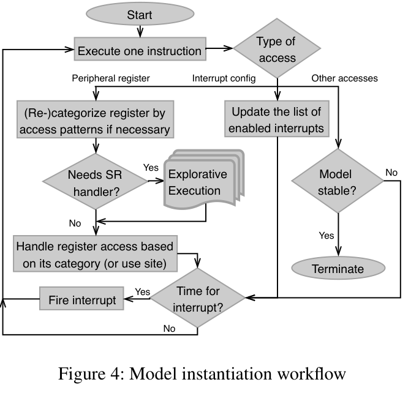
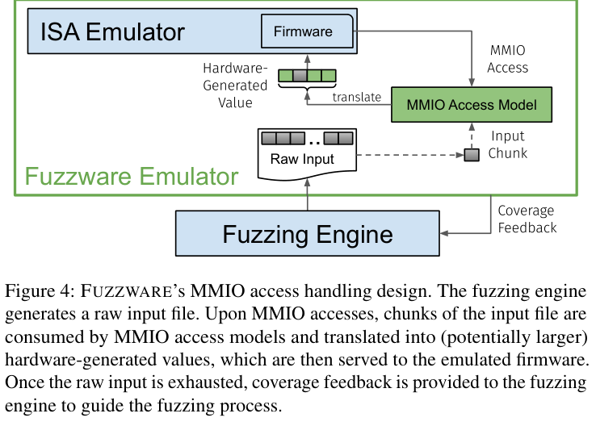
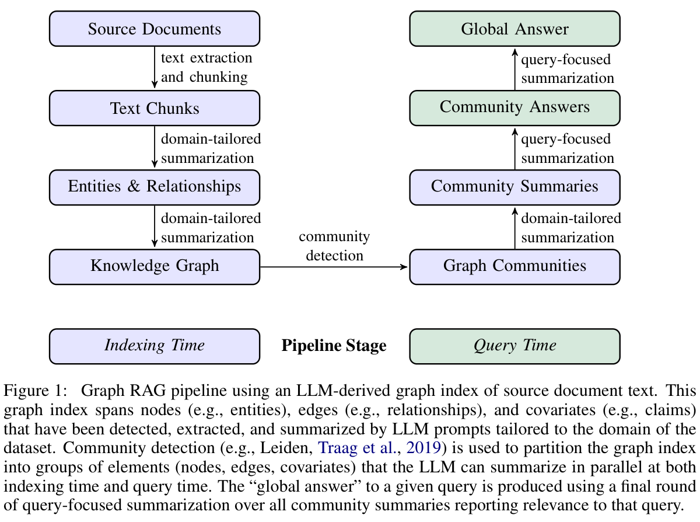

# 第三章实验方案：配图位置与论文原图参考

核实日期：2026-10-18（Asia/Shanghai）。

[打开离线选图页](index.html) · [查看7张原图总览](overview.png) · [来源、版本、页码、裁切范围与SHA-256](sources.json)

本目录保存 **6份公开论文PDF与7张论文原图**。3份为本轮新下载的TESSERACT、CRYLOGGER和Fuzzware；CPG、P2IM、GraphRAG复用已核实PDF，并重新核对相关图页。`chapter/3.tex` 的 **S01—S07** 是建议图位编号；本目录 **R01—R07** 是第三方原图编号，均不是正式论文图号。所有PDF页码从文件第一页起算，包含会议封面。

第三章配图应展示“材料如何进入实验、研究变量如何改变、依据什么独立核对”，第二章解释技术机制，第四章展示实际计数与页面。原图仅作取材参考，尚未插入正文。正式使用时按本文实验方案改绘并注明借鉴出处；原图中的数据、系统能力与结论归于原论文。

## 图位与绘制内容

| 图位与优先级 | 放置位置 | 建议图题与画法 | 论文参考 |
| --- | --- | --- | --- |
| S01，优先 | 3.1.1样本组成与真值标注末尾 | **样本组织与参考库配对实验设计**。上部以两个独立面板说明1071份已知覆盖与363份源码的组成及重叠；下部把同一源码、标签、代码、上下文送入149／226条参考条件，只改变参考记录，再做逐文件差异核对。数量只表示材料，不填TP或召回率。 | 本项目专用设计，须自绘。R01仅参考边界标法，其时间拆分不等于本文家族分组。 |
| S02，可选 | 3.2.3随机森林辅助识别末尾 | **家族分组交叉验证与模型冻结**。同源源码及构建变体同色同组；四折训练／验证矩阵接折外分数、开发选参及阈值冻结，最后连接新来源独立测试。历史留出复查另画支路。 | R01只参考材料用途和边界的标记；原图没有家族四折，不能直接充当RF实验流程。 |
| S03，可选 | 3.3.1构建配置、运行事件与外部服务关联末尾 | **同一业务任务的多源证据对照**。固定同一项目／配置／脚本，分CPG、运行事件、提供者三面板，标C0—C2、D0—D2、H0—H2。设置未启用、初始化后失败、支持但未使用等对照，标出独立真值与观测字段。 | R02参考路径，R03参考运行／日志／核查的步骤，R04参考跨过程、路径和参数变体的构造。 |
| S04，可选 | 3.3.2固件重托管与外设模型末尾 | **固件重托管的分级对照与事件核查**。同一固件、输入和预算进入F0—F3；F0比较静态标签，F1—F3比较预定业务状态和执行事件，阻塞／未知也保留；由独立轨迹核对。 | R05参考模型更新和执行循环，R06参考输入与MMIO访问模型的对应。本文分组与密码业务检查须自行补画。 |
| S05，优先 | 3.3.3 GraphRAG跨组件与跨业务查询末尾 | **GraphRAG跨组件查询的受控对照**。同一事实包、规范库、问题与模型进入G0—G3，用共享RSA验签组件连接两个终端，标过期边、互斥配置与缺失路径。审核答案只进入独立评分器，标总token与离线成本。 | R07参考索引／查询分区；按G0—G3改绘，不重复第二章完整GraphRAG原理图。 |
| S06，优先 | 3.4.1全环节场景与两个前端验证末尾 | **固件交付与双前端的分层验证链**。上泳道为终端源码→双架构构建→镜像，源码／真值独立保存；核对交付摘要、独立解包、原镜像扫描和组件身份，分x86业务执行与ARM64静态检查，连接终端前端。下泳道为网关独立源码／ELF的双版本、双架构扫描与复核，连接网关前端。分别核对输入与报告，离线回放与新任务分开。 | 属于本文交付和验收流程，没有一一对应的第三方论文原图，建议自绘。真实页面和结果矩阵留在第四章。 |
| S07，备选 | 3.4.2风险排序与受控迁移末尾 | **量子风险排序与受控迁移验证设计**。同一资产集比较初始／等权／扰动权重与独立专家排序；同一业务输入比较传统配置和PQC／混合候选的功能、互操作、回退与资源开销。未知参数保留未知。 | 没有提供一一对应的论文原图；选型依据正文已有NIST标准。避免再画迁移时间窗口，篇幅受限时优先省略。 |

建议首先选择 **S01、S05、S06三张**。若需要突出拟扩展的固件执行，可将S04作为第四张；若重点突出`qcs_ml`，可用S02替代。候选位置不要求全部插图，图中不预填尚未取得的实验成绩。

## 论文与原图

### R01：TESSERACT，材料组织与评价边界

Feargus Pendlebury, Fabio Pierazzi, Roberto Jordaney, Johannes Kinder, Lorenzo Cavallaro. **TESSERACT: Eliminating Experimental Bias in Malware Classification across Space and Time**. 28th USENIX Security Symposium, 2019, pp. 729–746。

[会议论文页](https://www.usenix.org/conference/usenixsecurity19/presentation/pendlebury) · [官方PDF](https://www.usenix.org/system/files/sec19-pendlebury.pdf) · [本地论文](papers/tesseract-pendlebury-2019.pdf)

- **原图1，PDF第4页**：按月展示原论文样本分布及训练／测试分界。
- 关键词：`experimental bias`、`train test split`、`data partition`。
- 可参考分界线、材料用途与分布的明确标记。原图的Android数量、年份、类别比例属于原论文，不能搬入本项目；原图不是家族分组四折或RF流程图。本文S01／S02仍需按自己的材料自绘。

### R02：CPG，路径与程序身份的表示

Fabian Yamaguchi, Nico Golde, Daniel Arp, Konrad Rieck. **Modeling and Discovering Vulnerabilities with Code Property Graphs**. IEEE Symposium on Security and Privacy, 2014, pp. 590–604. DOI：[10.1109/SP.2014.44](https://doi.org/10.1109/SP.2014.44)。

[作者公开PDF](https://fabianyamaguchi.com/files/2014-ieeesp.pdf) · [本地论文](papers/cpg-yamaguchi-2014.pdf)

- **原图4，PDF第5页**：共享程序节点上的多类型边。
- 关键词：`code property graph`、`control flow`、`data dependency`。
- 本章只借鉴同一代码中路径和位置的表示，用于C0—C2对照；原图没有本文配置约束、密码实验或比较组。第二章候选图也包含该原图，第三章应按对照设计改绘，避免再次放完整机制图。

### R03—R04：CRYLOGGER，运行观测与边界样例

Luca Piccolboni, Giuseppe Di Guglielmo, Luca P. Carloni, Simha Sethumadhavan. **CRYLOGGER: Detecting Crypto Misuses Dynamically**. 最终发表于IEEE Symposium on Security and Privacy, 2021，DOI：[10.1109/SP40001.2021.00010](https://doi.org/10.1109/SP40001.2021.00010)。**本目录保存2020-07-02的arXiv:2007.01061v1，18页，图号与页码以这份预印本为准**。

[arXiv论文页](https://arxiv.org/abs/2007.01061) · [固定v1 PDF](https://arxiv.org/pdf/2007.01061v1) · [本地论文](papers/crylogger-piccolboni-2020-v1.pdf)

- **R03：原图1，PDF第2页**：运行触发密码API、采集参数日志、独立执行规则检查。适合借鉴D0—D2中的执行、观测及核对步骤。
- **R04：原图10，PDF第17页**：基础、跨过程、路径、字段、多类及参数敏感样例。原图题说明前六类来自CryptoAPI-Bench，作者增加参数敏感类别；适合借鉴构造边界变体的方法。
- 关键词：`dynamic crypto analysis`、`runtime logging`、`API parameters`、`CryptoAPI-Bench`、`path sensitive`。
- 原方法面向Android／Java密码误用检测，既不是Linux uprobes／eBPF或HSM观测，也不是本工具已经接入的方案。本文应将输入、调用接口、返回状态和业务事件改绘为C/C++及电力软件任务，不能移用原论文的误用检出成绩。

### R05：P2IM，外设模型实例化的实验执行流程

Bo Feng, Alejandro Mera, Long Lu. **P2IM: Scalable and Hardware-independent Firmware Testing via Automatic Peripheral Interface Modeling**. 29th USENIX Security Symposium, 2020, pp. 1237–1254。

[会议论文页](https://www.usenix.org/conference/usenixsecurity20/presentation/feng) · [官方PDF](https://www.usenix.org/system/files/sec20-feng.pdf) · [本地论文](papers/p2im-feng-2020.pdf)

- **原图4，PDF第9页**：“Model instantiation workflow”，展示执行、访问分类、模型更新、中断及终止判断。
- 关键词：`firmware rehosting`、`peripheral modeling`、`P2IM`。
- 本次选择执行／建模工作流，区别于第二章已选的MCU交互和抽象模型原理图。可用于S04的执行循环，但原论文没有F0—F3、本文业务状态或密码事件评价，不能推定支持完整DMA建模。

### R06：Fuzzware，输入与MMIO访问模型的关联

Tobias Scharnowski, Nils Bars, Moritz Schloegel, Eric Gustafson, Marius Muench, Giovanni Vigna, Christopher Kruegel, Thorsten Holz, Ali Abbasi. **Fuzzware: Using Precise MMIO Modeling for Effective Firmware Fuzzing**. 31st USENIX Security Symposium, 2022, pp. 1239–1256。

[会议论文页](https://www.usenix.org/conference/usenixsecurity22/presentation/scharnowski) · [官方PDF](https://www.usenix.org/system/files/sec22-scharnowski.pdf) · [本地论文](papers/fuzzware-scharnowski-2022.pdf)

- **原图4，PDF第7页**：“MMIO access handling design”，展示输入、MMIO访问模型、仿真固件与覆盖反馈。
- 关键词：`Fuzzware`、`MMIO access model`、`rehosting`。
- 可参考S04中固定输入、加入模型后的处理路径。原图含覆盖引导模糊测试；本文拟评价受控状态与密码事件，需要独立改绘。未把Fuzzware的自动建模、模糊测试或覆盖成绩写成本工具的现有能力。

### R07：GraphRAG，索引／查询阶段与摘要成本

Darren Edge et al. **From Local to Global: A GraphRAG Approach to Query-Focused Summarization**. arXiv:2404.16130, 2024。所存为2025-02-19修订的v2，26页。

[arXiv论文页](https://arxiv.org/abs/2404.16130) · [固定v2 PDF](https://arxiv.org/pdf/2404.16130v2) · [本地论文](papers/graphrag-edge-2024-v2.pdf)

- **原图1，PDF第4页**：索引阶段与查询阶段的分区，以及社区摘要通往回答的路径。
- 关键词：`GraphRAG`、`community summaries`、`retrieval ablation`。
- S05借鉴索引／查询及成本分区，主体应改为同一事实、问题与模型下的G0—G3和独立评分器。原图没有本文的版本条件、路径兼容、真值隔离或G0—G3；不可直接标成本文消融设计。第二章已有同一机制图的参考，本章不再原样重复。

## 可复核信息

- `sources.json` 逐项保存论文标题、作者、公开地址、实际版本、PDF页数与摘要；每图保存原图号、1-based页码、裁切坐标、裁切区域原文、PNG尺寸、SHA-256、借鉴点和适用范围。
- 原图直接从对应PDF按216dpi裁取，保留图题，不翻译或改变内部关系；没有以生成图、网页示意或工具截图冒充论文原图。
- S01、S06、S07属于本文自己的样本、交付与迁移实验，未声称存在完全对应的论文原图；需要按注释自绘。
- `may_pic/` 是第二章原理素材，本目录仅保存第三章使用的论文与图，不复制其中无关素材。
- 第三章备份、论文审读说明、取材脚本、编译副本和核验记录保存在工作区外置的 `essay_support/2026-10-18/chapter3-review-figures/`。
