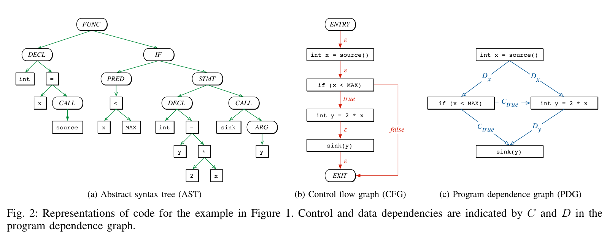
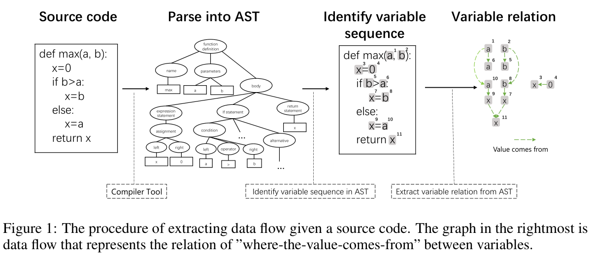
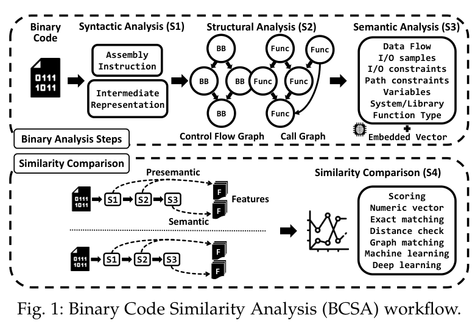
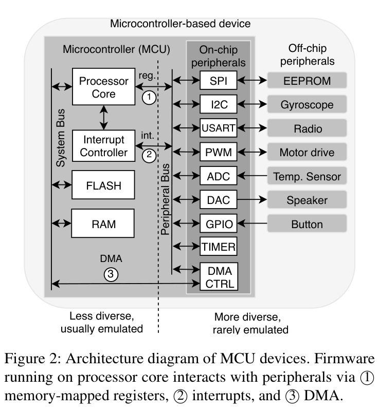
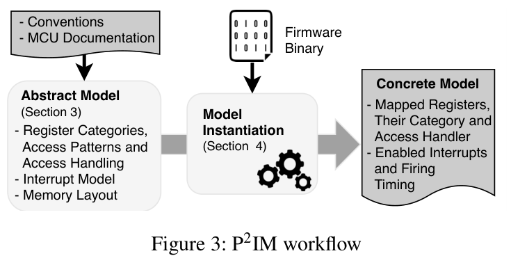
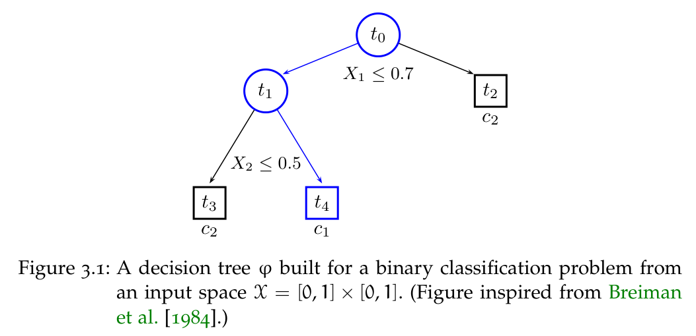

# 第二章实验原理：配图位置与论文原图参考

核实日期：2026-10-18（Asia/Shanghai）。

[打开离线选图页](index.html) · [查看8张参考图总览](overview.png) · [来源、原图题、页码、裁切范围及SHA-256](sources.json)

本目录保存 **6份论文／学位论文PDF与8张论文原图**。图片从对应PDF裁取，保留原图题，未翻译或改变图中关系。所有“PDF第几页”均从文件第一页起计数，包含会议封面，与印刷页码可能不同。

`chapter/2.tex` 已在6处加入普通 LaTeX 注释，编号为 F01—F06，描述本文适合自绘的图；目录中的 R01—R08 则是第三方论文参考图，编号与正式论文图号无关。这些参考图尚未插入正文。原图署名和结论属于原作者，不能作为本工具的架构、运行截图或实测结果；正式采用时注明出处并核对再利用条件。

## 建议放图的位置与内容

| 注释 | 插入位置 | 建议图题 | 应画出的关键内容 | 对应论文原图 |
| --- | --- | --- | --- | --- |
| F01，优先 | 2.2.1 源码语法、已知版本与配置依赖末尾 | 配置感知代码属性图与密码参数溯源 | 短代码中的密码接口、宏条件、业务入口；共享节点上叠加AST、控制流、数据依赖与调用边；展示参数后向切片和业务前向关系，保留行号与构建条件。 | R02为主要参考，R01与R03为备选。 |
| F02，优先 | 2.2.3 运算依赖与有界语义判定末尾 | 带输入身份的运算依赖与保守合流 | 对照“相同状态上的关联运算”与“无关输入上的相同操作”；再画分支合流，一致事实保留、分歧置unknown，注明字宽和指令位置。 | R03可参考数据来源连线，R04仅参考分析层次；均不直接展示本文合流规则。 |
| F03，优先 | 2.3.1 镜像提取与固件重托管末尾 | 固件组件恢复与外设接口建模原理 | 镜像—组件的包含关系与摘要映射；处理器、MMIO／中断模型及密码事件的交互；已有提取与静态分析用实线，拟开展的重托管与事件关联用虚线。 | R06为主要参考，R05解释处理器和外设的交互边界。 |
| F04，可选 | 2.4.1 随机森林的函数判定与文件聚合末尾 | 函数特征的森林判定与文件级聚合 | 函数向量→多树分裂→叶节点正类比例→跨树平均→跨函数最大值→阈值判定；候选排序森林单独画旁路。 | R07只参考单树画法，整幅森林与文件聚合必须按本文方法重绘。 |
| F05，优先 | 2.4.2 GraphRAG 的依赖检索与大模型解释末尾 | 面向跨组件业务依赖的GraphRAG原理 | 程序／配置／运行证据→带类型和版本条件的资产图；共享验签组件连接跨环节终端及业务；路径检索、社区摘要和规范片段共同支持附引用回答。 | R08。 |
| F06，备选 | 2.5 电力业务关联与量子风险排序中的迁移窗口公式之后 | 保护期限与迁移时间窗口 | 迁移准备期之后仍需保护最后一批数据，以其保密期限与假设量子能力到来时间比较；并列两种不等式情景，不使用确定预测年份。 | Mosca论文提供理论依据；本轮未核实到可提供的原图，不指定图号。第一章已有时间示意，可不重复。 |

控制篇幅时，建议采用 **F01、F03、F05三张主图**；F02在需要解释语义识别时增加，F04在需要突出 `qcs_ml` 时增加，F06通常可以省略。候选位置不意味着六张全部进入正文。每张图应解释一种机制，避免再次绘制重复的工具总流程。

## 论文与原图

### 1. 代码属性图：Yamaguchi等，2014

Fabian Yamaguchi, Nico Golde, Daniel Arp, Konrad Rieck. **Modeling and Discovering Vulnerabilities with Code Property Graphs**. IEEE Symposium on Security and Privacy, 2014, pp. 590–604. DOI: [10.1109/SP.2014.44](https://doi.org/10.1109/SP.2014.44)。

[作者公开PDF](https://fabianyamaguchi.com/files/2014-ieeesp.pdf) · [本地论文PDF](papers/cpg-yamaguchi-2014.pdf)

- **R01：原图2，PDF第3页**，展示AST、CFG和PDG。适合作为不同代码表示的并列布局参考。
- **R02：原图4，PDF第5页**，在共享节点上合并多类型边，最适合F01。
- 关键词：`code property graph`、`AST CFG PDG`、`program slicing`。
- 本文的构建配置、密码参数溯源及业务关系需另行改绘，不能将原文漏洞发现结论挪用为密码算法识别结果。正文已补入该原始论文引用，Joern文档保留为扩展实现参考。

### 2. 数据流表示：Guo等，GraphCodeBERT

Daya Guo et al. **GraphCodeBERT: Pre-training Code Representations with Data Flow**. ICLR 2021；2020年首次预印本，arXiv:2009.08366，所存PDF为v4。

[arXiv论文页](https://arxiv.org/abs/2009.08366) · [固定版本PDF](https://arxiv.org/pdf/2009.08366v4) · [本地论文PDF](papers/graphcodebert-guo-2020-v4.pdf)

- **R03：原图1，PDF第3页**，展示源码、AST、变量出现位置和取值来源关系。
- 关键词：`GraphCodeBERT`、`data flow`、`where the value comes from`。
- 适合作为F01的替代布局，或F02取值来源连线的参考。原图输入是Python源码，不是二进制IR；也不展示本文的掩码匹配或unknown合流规则。本文尚未接入该预训练模型。

### 3. 二进制分析层次：Kim等，2020作者稿

Dongkwan Kim, Eunsoo Kim, Sang Kil Cha, Sooel Son, Yongdae Kim. **Revisiting Binary Code Similarity Analysis using Interpretable Feature Engineering and Lessons Learned**. 本目录使用作者2020年公开稿，21页；不以该稿代称其他最终发表版本。

[作者PDF](https://0xdkay.me/pub/2020/kim-arxiv2020.pdf) · [本地论文PDF](papers/binkit-kim-2020.pdf)

- **R04：原图1，PDF第3页**，图题为“Binary Code Similarity Analysis (BCSA) workflow”。
- 关键词：`binary code similarity`、`syntactic structural semantic analysis`、`BinKit`。
- 复用2026-10-16已经下载和核实的原始PDF。本轮再次核查原图位置。仅借鉴二进制语法、结构和语义的层次组织，不将其完整相似性流程作为QCS架构；本文的保守合流图仍需根据自己的规则绘制。

### 4. 固件外设建模：Feng、Mera、Lu，P2IM

Bo Feng, Alejandro Mera, Long Lu. **P2IM: Scalable and Hardware-independent Firmware Testing via Automatic Peripheral Interface Modeling**. 29th USENIX Security Symposium, 2020, pp. 1237–1254。

[会议论文页](https://www.usenix.org/conference/usenixsecurity20/presentation/feng) · [会议官方PDF](https://www.usenix.org/system/files/sec20-feng.pdf) · [本地论文PDF](papers/p2im-feng-2020.pdf)

- **R05：原图2，PDF第4页，印刷页1239**，MCU处理器与外设的交互结构。
- **R06：原图3，PDF第5页，印刷页1240**，抽象模型经固件驱动实例化为具体模型，适合作为F03下半部的机制参考。
- 关键词：`firmware rehosting`、`MMIO`、`peripheral interface modeling`、`P2IM`。
- R05画出了MMIO、中断和DMA三类接口，但原文明确将DMA排除在处理范围之外。图中的接口存在不等于方法支持全部接口。本文仍需另外画出密码事件和电力业务关联，并明确重托管属于拟开展研究。

### 5. 决策树与森林：Louppe博士论文

Gilles Louppe. **Understanding Random Forests: From Theory to Practice**. PhD dissertation, University of Liège, 2014. arXiv:1407.7502；所存PDF为2015-06-03修订的v3，223页。

[arXiv论文页](https://arxiv.org/abs/1407.7502) · [固定版本PDF](https://arxiv.org/pdf/1407.7502v3) · [本地学位论文PDF](papers/rf-louppe-2014-v3.pdf)

- **R07：原图3.1，PDF第40页，印刷页28**，特征分裂、路径和叶节点类别的单树例子。
- 关键词：`random forest`、`decision tree`、`probability averaging`。
- 原图是单树硬标签图，原图题注明受Breiman等1984年著作启发。它只能参考树的画法，不能直接标为 `qcs_ml` 的森林架构或概率聚合原图。
- F04应按本文公式补画多树正类比例平均、文件内函数分数max和阈值判定；随机森林理论继续使用正文已有的Leo Breiman, **Random Forests**, Machine Learning 45, 5–32, 2001，DOI：[10.1023/A:1010933404324](https://doi.org/10.1023/A:1010933404324)。未声称Breiman原论文存在本文这样的森林流程图。

### 6. GraphRAG：Edge等

Darren Edge et al. **From Local to Global: A GraphRAG Approach to Query-Focused Summarization**. arXiv:2404.16130, 2024. 所存PDF为2025-02-19修订的v2，26页。

[arXiv论文页](https://arxiv.org/abs/2404.16130) · [固定版本PDF](https://arxiv.org/pdf/2404.16130v2) · [本地论文PDF](papers/graphrag-edge-2024-v2.pdf)

- **R08：原图1，PDF第4页**，文档分块、实体关系图、社区摘要与全局回答的组织。
- 关键词：`GraphRAG`、`community summaries`、`cross-component dependency`。
- F05可借鉴其索引与查询的分区布局，但本文拟采用的是电力密码资产图，还增加配置版本约束和类型兼容的依赖路径检索。程序事实由已核验的扫描、配置、运行证据提供；LLM抽取关系先进入候选层。不能把原图中由LLM抽取实体关系的全部步骤直接视为已验证的程序事实。

## 时间窗口备选图的出处边界

F06的理论依据为Michele Mosca, **Cybersecurity in an Era with Quantum Computers: Will We Be Ready?**, IEEE Security & Privacy, 16(5), 38–41, 2018，正文已有引用。本轮未核实到可供裁图的该文原图，因此未提供原图文件、原图号或声称已有原图。可按正文不等式自绘情景图；项目第一章已有的迁移时间示意仍是项目示意图，不能称为Mosca论文原图。

## 文件与核实方式

- `papers/`：上述6份可打开的PDF；`figures/`：8张PNG。
- `index.html`：可离线逐图查看出处、页码、借鉴点及适用边界。
- `sources.json`：PDF与PNG摘要、页数、原图号、从1开始的PDF页码、裁切矩形、裁切区域原文和处理说明。
- `overview.png`：全部8张候选的缩略图，保留原图号与PDF页码。
- 原PDF公开稿、会议版和学位论文的类型均按实际文件标注；本轮未使用博客、会议幻灯片或生成图冒充论文原图。
- 下载回执、未采用候选、章节备份、构建与核验材料保存在工作区的 `essay_support/2026-10-18/principles-review-figures/`，未混入本目录的选图结果。
